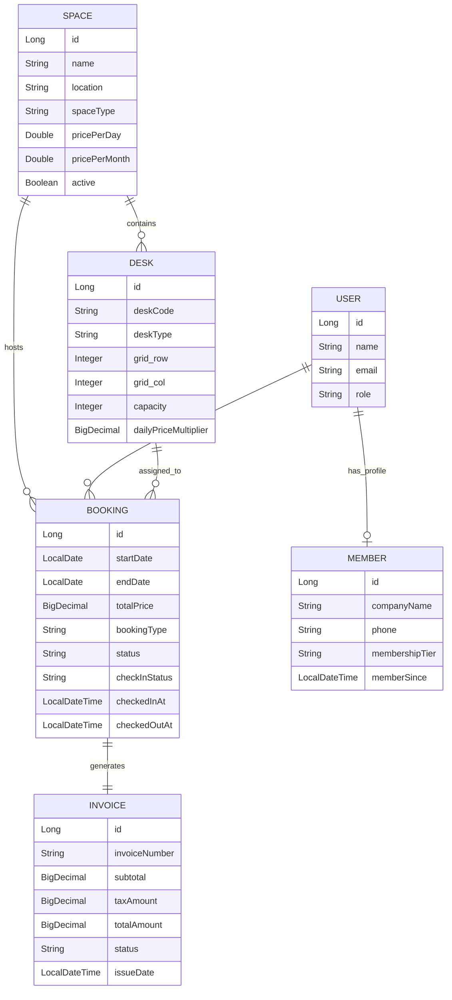

# 🏢 WorkNest — Product Requirements Document (PRD) & Project Report

> **Project Name:** WorkNest Co-working Space Booking Platform  
> **Type:** Full-Stack Web Application (Spring Boot + React + MySQL)  
> **Target Audience:** Co-working Space Operators, Remote Workers, Freelancers, Startups & Enterprises  
> **Status:** Production-Ready & Feature-Complete  

---

## 1. 📌 Executive Summary (Project Overview in Simple Terms)
**WorkNest** ek modern **Co-Working Space Booking & Management Platform** hai. 

Jaise movie tickets ke liye **BookMyShow** me seat select karte hain ya flight booking me plane ki seat choose karte hain, waise hi WorkNest users ko **live interactive Floor Seat-Map** par apne pasand ka **Desk (Hot/Dedicated)** ya **Private Soundproof Cabin** select karke **Daily Pass** ya **Monthly Pass** book karne ki suvidha deta hai.

Iske alawa platform par real-time check-in/out tracking aur automatic **GST Tax Invoicing** aur **Member Organization Profile** integrated hai.

---

## 2. 🎯 Core Problem Statement & Solution

| Problem (Kyun banaya?) | WorkNest Solution (Kaise solve kiya?) |
|---|---|
| **Blind Booking:** Users ko nahi pata hota ki unhe kaunsa desk ya cabin mil raha hai (window seat, AC ke paas, ya team ke sath). | **Live Visual Seat-Map:** Interactive floor plan jisme open desks aur private cabins ki real-time availability dikhti hai. |
| **Double Booking Conflict:** Same dates par do log ek hi seat book kar lete hain. | **Overlapping Date Lock:** Database-level queries jo date range match karke real-time unavailable mark karti hain. |
| **Manual Attendance & Reception Hassle:** Kon kab aaya aur gaya uska koi digital record nahi rehta. | **One-Click Check-In / Check-Out:** Live status badges aur exact timestamps ke sath check-in tracking. |
| **Invoicing & GST Compliance Delay:** Manual bills banane me time lagta hai. | **Instant Automated Tax Invoice:** Booking confirm hote hi itemized 18% GST invoice banta hai jise 1-click print/download kiya ja sakta hai. |

---

## 3. 🧩 Architecture & Core Entities (Data Model)

WorkNest **5 Core Entities** par based hai:

### Explanation of 5 Entities:
1. **Space (Workspace Location):**  
   Shehar aur area ke hisab se co-working branches (e.g., *Indiranagar Hub Bengaluru*, *Cyber City Gurugram*). Base day rate aur month rate hold karta hai.
2. **Desk (Seat / Cabin):**  
   Space ke andar individual units (e.g., `D-11`, `D-12` as Flex Desks, `C-31`, `C-32` as 4-6 Seater Private Cabins). Floor map ke `grid_row` aur `grid_col` coordinates hold karta hai.
3. **User & Member:**  
   - `User`: Authentication (Email, BCrypt Password, JWT Token, Role).
   - `Member`: Business details jaise Company Name, Phone, aur Membership Tier (`BASIC`, `PRO`, `ENTERPRISE`).
4. **Booking:**  
   Reservation record jo User, Space, aur Desk ko link karta hai, plan choose karta hai (`DAILY` ya `MONTHLY`), aur check-in timestamps track karta hai.
5. **Invoice:**  
   Booking complete hote hi auto-generate hota hai. Subtotal, 18% GST tax, Total Price, Issue Date aur Unique Invoice Number (`INV-xxxx`) store karta hai.

---

## 4. 🚀 Key Features Walkthrough

### 1️⃣ Real-Time Seat-Map Availability View
- **Live Visual Grid:** Floor plan view with entrance indicator, bays, and private cabin areas.
- **Color-Coded Status:**
  - 🟢 **Light Green:** Available Hot Desk (`₹499/day`)
  - 🟣 **Light Purple:** Available Private Cabin Suite (`₹749/day`)
  - 🟢 **Dark Green:** Selected Seat
  - 🔴 **Red:** Already Booked by another member
- **Date Dynamic:** Jaise hi user Check-In ya Check-Out date change karta hai, map turant refresh ho kar un dates par booked desks ko lock kar deta hai.

### 2️⃣ Flexible Pass Booking (Day / Month Pass)
- **Daily Pass:** Single day ya multiple days ke hisab se dynamic pricing calculation.
- **Monthly Pass:** Long term stay ke liye 30-day block discounted rate.
- **Cabin Multiplier:** Private cabins automatically apply executive capacity multiplier (1.5x) in real time.

### 3️⃣ Check-in / Check-out Tracking
- Jab member space me physically pahunchta hai, **My Bookings** screen par **📍 Check-in Now** button click karta hai.
- Status update hota hai: `NOT_CHECKED_IN` ➔ `CHECKED_IN` (Exact timestamp record hota hai).
- Workday khatam hone par **🚪 Check-out** click karte hi status `CHECKED_OUT` aur booking `COMPLETED` mark ho jati hai.

### 4️⃣ Automated Tax Invoice Generation & Printing
- Har confirmed booking ke sath computer-generated **TAX INVOICE** create hota hai.
- **Breakdown:**
  - Workspace details & Assigned Seat/Cabin code
  - Plan type & date period
  - Base Subtotal
  - **18% Integrated GST** calculation
  - Total Paid & GSTIN / Legal business credentials
- **Print / PDF Ready:** Inbuilt `@media print` styling ke sath user 1-click me printable receipt download kar sakta hai.

### 5️⃣ Member Profile & Organization Settings
- User apni Company ka naam, contact number aur membership tier select aur update kar sakta hai.

---

## 5. 🛠️ Technology Stack

| Layer | Technology Used |
|---|---|
| **Frontend Framework** | React 19 + Vite 8 |
| **Routing** | React Router DOM v7 |
| **Styling** | Modern Vanilla CSS (Clean modern typography, interactive cards, micro-animations, glassmorphism, responsive grid) |
| **Backend Framework** | Spring Boot 4 / Java 21 |
| **Security & Auth** | Spring Security 6 + JWT (JSON Web Tokens) + BCrypt Password Encoding |
| **Database & ORM** | MySQL 8.0 + Spring Data JPA / Hibernate |

---

## 6. 🌐 API Endpoints Reference

### 🔐 Auth & Members
- `POST /api/auth/register` — New member registration.
- `POST /api/auth/login` — Login & JWT token retrieval.
- `GET /api/members/me` — Fetch current logged-in member organization profile.
- `PUT /api/members/me` — Update company name, phone, or membership tier.

### 🏢 Spaces & Seat Map
- `GET /api/spaces` — List all active co-working spaces.
- `GET /api/spaces/{id}` — Get single workspace details.
- `GET /api/spaces/availability?startDate=...&endDate=...` — Filter spaces having free capacity.
- `GET /api/bookings/spaces/{spaceId}/seat-map?startDate=...&endDate=...` — **Seat-Map live availability** for every desk & cabin slot.

### 📅 Bookings & Check-In Tracking
- `POST /api/bookings` — Create a new daily or monthly reservation with desk assignment.
- `GET /api/bookings/myBookings` — List all user reservations with live check-in statuses.
- `PATCH /api/bookings/{id}/check-in` — Member check-in with timestamp.
- `PATCH /api/bookings/{id}/check-out` — Member check-out with timestamp.
- `PATCH /api/bookings/{id}/cancel` — Cancel booking.

### 📄 Invoices
- `GET /api/invoices/myInvoices` — List all invoices of current member.
- `GET /api/invoices/booking/{bookingId}` — Fetch tax invoice receipt for a specific reservation.

---

## 7. 💡 Demo Flow (How to Present to Stakeholders/Evaluation)
1. **Explore Workspaces:** Open `http://localhost:5173/` aur space choose karein.
2. **Interactive Seat Map:** Dates select karein, seat-map par desk (e.g. `D-11`) ya cabin (e.g. `C-31`) par click karke select karein.
3. **Confirm Booking:** Click **Confirm & Book Now**. Turant success message aur seat lock notification aayega.
4. **View Tax Invoice:** Click **View Tax Invoice** — Itemized 18% GST tax invoice modal show hoga jise print/download kar sakte hain.
5. **Check-In Tracking:** Navbar me **My Bookings** par jayein, **Check-in Now** button click karein — status green ho jayega aur exact time log ho jayega.
6. **Member Profile:** **Member Profile** me jakar company name update karein.
